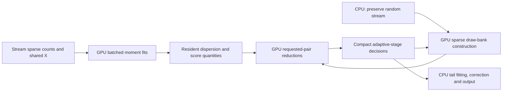

# A resident GPU design for SCEPTRE

This design concerns Broad Institute `pysceptre` at
`7adaa9f5fda12e0cf87df972c8fe73b73ef13e7d`, with the complement-control CRT
path as the first implementation target. The statistical decomposition also
applies to the R implementation, but Python timings do not establish R speedups.
It supersedes the earlier strategy of treating target GLMs or score matmuls as
independent GPU ports. These are design conclusions, not a released backend.

## Why the earlier unit of work was too small

On the frozen 201,158-cell backed workload, replacing target fits alone gave
196.302 seconds CPU versus 195.692 seconds GPU in two reversed-order pairs;
whole-process GPU time was worse. Warm target fits were faster, but represented
too little of the workflow. All 2,056 result rows agreed exactly in those runs.

An older single pinned-CPU RAM profile of the same scientific workload measured
about 54 seconds in drawing assignments, 34 in dispersion, 18 in Poisson fits,
21 in low-level tests (scores plus tail fitting/checks) and 5 in score
reconstruction. The `test_kernel` label wraps `run_low_level_test_full`, not
just a sparse matmul. These selected phase
clocks are from a separate campaign, not a timing partition of the new pairs.
They nevertheless show why making only scores fast cannot deliver a large
overall gain. Sampling and response fitting must be addressed together.

The first score diagnostic confirms substantial resident parallelism: for 8
synthetic genes, 20,000 cells, 499 draws and 400 cells per draw, five resident
repetitions had median 5.600 ms for the CPU gene loop, 11.123 ms for CPU sparse
matrix batching and 0.187 ms for the GPU batch, including result download.
This excludes device setup and initial transfers. It establishes a component
opportunity and distinguishes batching from the device gain; it is not a
workflow speedup. The complete RAM comparison is recorded separately.

## The algebra to organize around

Let X be the shared n-by-p covariate matrix, y_g a response, mu_g its fitted
mean, and theta_g its dispersion. Define

    w_g = mu_g / (1 + mu_g/theta_g)
    a_g = (y_g - mu_g) / (1 + mu_g/theta_g)
    H_g = X' diag(w_g) X.

For a binary resampled assignment z, the existing adjusted score is

    numerator = z' a_g
    v = X' diag(w_g) z
    denominator_squared = z' w_g - v' inverse(H_g) v.

Thus each draw needs p+2 cell reductions, followed by a tiny quadratic form.
The existing D representation is one factorization of that quadratic form.
There is no need to refit the response for each draw, nor to export a dense
per-cell D and then reimport it. Factor H once per gene; keep all large
intermediates on the device. Cholesky/solve and the eigen-based reference need
separate conditioning and numerical checks. For weighted or repeated-entry
banks preserve upstream listing/weight semantics, including the existing
linear-in-multiplicity lower-left term; do not square coalesced multiplicities.

For a bank Z_t of draws associated with target t, compute

    Z_t [a_g, w_g, diag(w_g) X]

for the requested genes, then evaluate the small quadratic forms. The
gene-target family is a sparse graph. It is wasteful to multiply every fitted
gene by every target when most edges were never requested. Pack tiles of
genes incident to the same target or similar target neighborhoods; preserve
the requested row identities independently of execution order.

## Response fitting: exploit sufficient statistics

Poisson IRLS after initialization can be expressed as Newton updates:

    mu = exp(X beta)
    gradient = X'y - X'mu
    H = X' diag(mu) X
    beta_next = beta + solve(H, gradient).

The counts are fixed. Compute X'y, sum(y), and sum(y log y) once, from sparse
counts. Provided the mean floor is inactive, the same Poisson deviance is

    2 [sum(y log y) - beta'X'y - sum(y) + sum(mu)].

This avoids rereading dense y and constructing dense working responses in
every iteration. Preserve the original y+0.1 initialization; its initial
weighted moments also have a sparse correction to a shared constant baseline.
Use explicit floor corrections or the reference fallback when clipping occurs.
Use FP64. Reordered arithmetic still needs testing; equality of likelihoods
does not prove identical stopping iterations or downstream dispersions.

More specifically, writing c=0.1, initialization uses

    H0 = c X'X + X' diag(y) X
    rhs0 = X' [(y+c) log(y+c) - c].

The zero-count contribution to rhs0 is the shared baseline c log(c)-c;
nonzero counts supply sparse corrections. A fused iteration can load a tile
of X, evaluate exp(X beta) across a gene batch, and write only partial small
moments. It need not store a full mu array until fitting finishes. A fixed
cell-reduction tree can also make results less dependent on gene-batch width.

For p small, solving p-by-p systems is cheap. The work is evaluating means
and reducing moments over millions of cell-gene entries. Run dozens of genes
together, keep convergence masks on-device, and fuse mean/gradient/Hessian/
deviance accumulation where profiling warrants it. Use only the symmetric
p(p+1)/2 Hessian entries. Avoid a host synchronization for each gene/iteration.
The binomial assignment fit has the same fixed X'y opportunity.

## Dispersion: another resident reduction, with a sensitive boundary

Keep the Poisson means resident while estimating theta. The CPU already
deduplicates counts before special-function evaluation, so simply replacing
SciPy digamma calls would miss most of the opportunity. Batch genes and fuse
per-cell score/information reductions instead of materializing many temporary
arrays and transferring means back to the CPU.

Integer counts permit the identities

    digamma(theta+y) - digamma(theta) = sum_{k=0}^{y-1} 1/(theta+k)
    trigamma(theta) - trigamma(theta+y) = sum_{k=0}^{y-1} 1/(theta+k)^2.

A count histogram can reduce these terms. The remaining MLE score per cell is

    H_y(theta) - log1p(mu/theta) + (mu-y)/(theta+mu),

and the information per cell is

    H2_y(theta) - (mu^2 + theta*y) / [theta*(theta+mu)^2].

These are mathematical rearrangements, not guarantees of reference floating
point behavior. Near-Poisson fits are sensitive to cancellation and Newton
paths. Preserve MLE/MM/pilot fallbacks and clamp behavior; report method changes
as well as raw/clamped theta differences. The allowed guide-probability
tolerance does not authorize a dispersion tolerance. Start with the existing
formula in batched FP64; evaluate stable rearrangements as a separately
identified candidate. Unstable genes can use a visible CPU fallback.

The integer-count structure can avoid densifying y here too. In the MLE score,
the histogram supplies sum(H_y); the dense part depends only on mu and theta,
and the y-dependent remainder is -sum_nonzero(y/(theta+mu)). The information
has the sparse remainder -sum_nonzero(y/(theta+mu)^2). Even the pilot estimate
uses n / [n - 2 sum_nonzero(y/mu) + sum_nonzero(y^2/mu^2)]. This splits a dense
mean reduction from a sparse count correction instead of repeatedly traversing
dense count arrays. All such regrouping needs the same numerical gates.

## Sampling: preserve sparsity and the actual random stream

Dense independent coins cost O(n B) per target; sparse geometric gaps cost
roughly O(n + B sum(p_i)), with substantial padding in this implementation.
For example, n=200,000, B=499 and an average probability .002 means about
200,000 inclusions versus 100 million dense coins. A GPU can lose an apparent
hardware advantage by doing hundreds of times more work. Benchmark the sparse
route first rather than assuming a dense tensor is the appropriate interface.
At higher densities or large reuse, a dense/bit-packed representation may win;
select using measured density, memory and family reuse rather than a blanket
rule that sparse is always faster. It still must preserve the required draws.

The current exact sampler also requests at least ten padded gaps per live
cell. Most of those entries can overshoot the draw budget. Changing this
padding changes consumption of the target's random stream. Preserve it when
comparing with the current seed contract.

Inspecting NumPy 2.5.4's implementation revealed a useful split: for p<1/3,
geometric inversion is ceil(-E/log1p(-p)), where E is generated by NumPy's
standard-exponential routine. It is NOT a simple uniform per gap: that routine
uses rejection. A candidate can leave exponential generation on the CPU,
preserve its exact state progression, and send blocks to the GPU for inversion,
segmented scans, filtering and grouping. Cache log1p(-p) per cell rather than
recomputing it for every padded gap. Higher-probability search branches and
overflow boundaries need explicit handling/fallback. Validate every integer
gap, completed draw bank and final RNG state; equal distributions are weaker.

After segmented scans/filtering, a device radix sort on packed (draw, cell)
keys can build rows with ascending cells, matching the CPU ordering. Use a
32-bit key only when the checked product/ranges permit it; otherwise use
64-bit. Decode sorted keys and compute row offsets on-device. This avoids a
host counting sort and several expanded host arrays. Atomic scatter alone
would produce varying cell order and therefore varying floating-point score
sums, even if the sampled memberships were identical. Preserve multiplicities.

A synthetic Mac check of 3.4 million low-probability gaps found zero changed
gaps and identical final PCG state after this split. Exponential generation
took 0.0209 seconds versus 0.0416 seconds for the original geometric call;
this is a CPU diagnostic, not a GPU timing or a real-data validation.

Pipeline CPU generation of target t+1's random block with GPU reductions for
target t. Measure which part of sampling is RNG versus deterministic array
work. If the remaining CPU RNG is the bottleneck, only then consider an exact
PCG/Ziggurat device implementation. Replacing it with cuRAND Philox changes
the stream and is a separate scientific/reproducibility decision.

## Hardware execution and memory

Upload X and each sparse count block once. Keep means, dispersion workspaces,
score tiles, small factors and active draw banks resident. Double-buffer
bounded host/device input blocks; export compact statistics and diagnostics.
The target is sustained cell/edge throughput, not GPU utilization alone.

For backed input, use that same count block for pairwise nonzero-count QC,
fitting, dispersion and score preparation before eviction. A GPU fit followed
by another host read of the same gene loses a major benefit of residency.
The existing 512-row reader cache can evict a calibration panel before later
passes use it. Larger host caching and single-pass CPU scheduling are separate
controls: their benefit must not be attributed entirely to GPU arithmetic.
Sparse nonzero indicators times target membership matrices can compute the
existing QC counts without changing thresholds or eligibility.

There is ample parallel work across genes, cells and draw rows; individual
tiny solves and Python-dispatched scalar kernels are poor scheduling units.
For irregular score gathers, memory layout matters as much as arithmetic.
At sufficient tile width, neighboring threads should read neighboring gene/
moment columns for a selected cell and reuse the sparse row indices. Test
row-major CSR SpMM (ALG2) against the current CuPy column-major path before
writing a custom kernel. FP64 and deterministic-algorithm requirements must
be explicit. cuSPARSE's default algorithm is not a bitwise guarantee.

A single gene's p+2 FP64 score vectors at n=201,158 and p=4 occupy about
9.21 MiB; 32 genes occupy about 295 MiB. Materializing all 987 calibration
genes would use about 8.88 GiB for these vectors alone. Large VRAM permits
reuse, but does not justify retaining every bank/temporary. Use an explicit
budget for live tiles, counts, fit workspaces, factors, banks and allocator
headroom. Schedule tiles by the requested pair graph and available memory.
On a large-memory B200, retaining the whole frozen calibration score panel may
be preferable to an arbitrary tiny tile budget. On a smaller GPU, evict by the
remaining edges in the pair graph, not by Python function return boundaries.

The p=4 dense shared-design example is the easiest initial target. With many
categorical covariates, preserve the structured design and reduce by levels;
materializing n-by-p-squared outer products can become the wrong algorithm.
For NT-cell controls, the cell subset/design is target-specific: group many
genes sharing that subset rather than pretending there is one global fit.
These need independent performance and scientific checks.

Keep the adaptive budget: first-stage draws for all eligible pairs, compact
the survivors, then produce/score later-stage banks only when needed. Carry
the seed/substream and prefix rules through that scheduling. Do not quietly
increase budgets or generate a different family to make the GPU busier.

## Implementation order and acceptance

The first step has a bounded actual-data result. Job 9376218 used 32 frozen
discovery genes, all 201,158 retained cells and four covariates on one B200,
with one pinned CPU. The untouched CPU width-one Poisson fits took 0.488 s.
Three CPU sufficient-statistic batch runs took 0.428, 0.253 and 0.282 s.
GPU width-32 resident fits took 0.00586, 0.00453 and 0.00456 s after earlier
widths had initialized the runtime/kernels. Width-32 upload was 0.00732 s and
the diagnostic download of coefficients AND all means was 0.00676 s.

Cold costs are substantial: the first device upload/initialization took
1.520 s and the first width-one GPU fit took 22.164 s. These cannot be omitted
when assessing a fresh small analysis. This is a component experiment, not a
full-family speedup. It still materializes dense y for initialization and
uses several unfused CuPy operations; sparse initialization and fused moment
reductions described above are not yet implemented.

At width 32, maximum coefficient difference from the width-one CPU reference
was 7.94e-12, mean difference 5.61e-10, and no convergence/iteration flags
changed. Passing both means to the unchanged CPU theta routine gave maximum
clamped theta difference 9.34e-13 with zero method changes on these genes.
Widths one/eight also converged with unchanged iterations and methods.
This does not cover pathological or near-Poisson genes generally, nor does it
qualify a GPU dispersion implementation.

The same job checked 20,047,888 padded geometric gaps for four actual target
groups at B=499. Device exponential-to-geometric inversion changed zero
integers, and every checked final PCG state agreed. Original CPU geometric
calls summed to 0.23245 s; CPU exponential generation summed to 0.08416 s.
The first device inversion incurred 1.111 s of initialization/JIT; subsequent
individual block transforms were about 0.00013--0.00019 s, excluding input/
result copies. The harness redundantly calculated reference and candidate
gaps for validation and still used CPU scans/grouping. Its instrumented
elapsed is not a sampler acceleration result. GPU scans, packing/sorting and
complete-bank validation remain to implement.

The local raw receipt is `tools/gpu/evidence/resident/diagnostic.json`.
`executed-source/` preserves the submitted diagnostic before formatting-only
cleanup; `source.sha256` binds that executed version. The full score-workflow
follow-up is separately documented in `gpu-feasibility.md` and was slower
than stock CPU despite its fast resident kernel. These findings support the
new decomposition without claiming it is already an integrated solution.

1. Measure and validate sufficient-statistic response batches, including
   batch-width variation and the effect on unchanged CPU theta estimation.
2. Implement resident batched theta and score preparation. Verify fallback
   identities, eigen/conditioning diagnostics and final adjusted scores.
3. Split and pipeline the exact sampler without changing its stream; measure
   the CPU-only reformulation separately from the device contribution.
4. Join these into one resident execution path with sparse pair scheduling and
   all adaptive stages. Retain CPU tail fitting/BH initially if their cost is
   small; moving every last scalar operation is not the objective.
   The existing skew-normal check can make up to 19 separate SciPy SF calls
   per pair. Batch those calls and measure them separately from score
   contraction. GPU sorting/moments can return only required quantiles,
   moments, exceedance counts and diagnostics; keep the same CPU SF initially
   rather than silently substituting a new extreme-tail implementation.
5. Compare the untouched CPU baseline, CPU algorithmic reformulation and GPU
   implementation on complete frozen calibration/power/discovery families,
   fresh children, reversed order, same CPU policy and input bytes. Report
   inference and whole-process times, transfers, peak host/device memory,
   fallbacks and numerical/decision differences separately.
   The one-pinned-CPU comparisons isolate these prototypes. A practical GPU
   claim must also compare the mature CPU path at its intended production
   worker/thread configuration and account for allocated CPU/GPU resources.

The gate is meaningful end-to-end improvement under the same scientific work.
No specific speedup is yet established for this proposed resident design.

## Primary sources

- [CUDA Best Practices](https://docs.nvidia.com/cuda/cuda-c-best-practices-guide/index.html): retain intermediates on-device, minimize transfers, measure the whole application.
- [cuSPARSE 12.8](https://docs.nvidia.com/cuda/archive/12.8.1/cusparse/index.html): row/column-major algorithm choices, reusable preprocessing, and deterministic-algorithm limits.
- [GE-SpMM](https://arxiv.org/abs/2007.03179): sparse-row reuse and memory coalescing across dense columns; its published gains are not SCEPTRE estimates.
- [NumPy 2.5.4 geometric implementation](https://github.com/numpy/numpy/blob/v2.5.4/numpy/random/src/distributions/distributions.c#L996): exponential inversion below p=1/3 and the separate search branch.
- [cuRAND host API](https://docs.nvidia.com/cuda/curand/host-api-overview.html): generator-specific reproducibility; a seed alone does not establish equivalence to NumPy's PCG stream.
